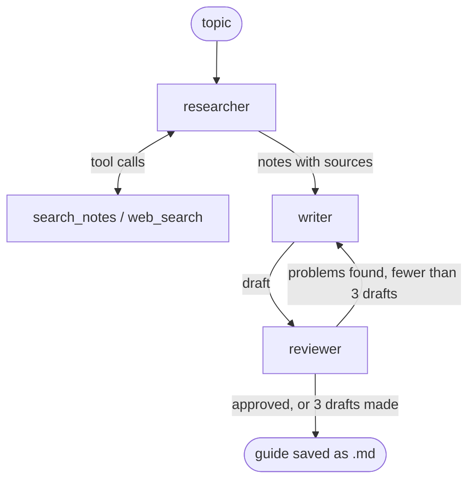

# research-crew

## What it does
Give it a topic, and three AI agents (a researcher, a writer and a reviewer) turn your lecture PDFs and a web search into a short revision guide with sources and self-test questions.
Everything runs on your own computer with local Ollama models, built with LangGraph.

## How it works



| File | What it does |
|---|---|
| `main.py` | Starts the crew on your topic, prints each step, saves the guide and logs every step to `logs/trace.jsonl` |
| `graph.py` | Connects the agents into a LangGraph graph and decides when to revise or stop |
| `researcher.py` | Agent loop that calls tools and returns 6–10 bullet points with sources |
| `writer.py` | Turns the notes into a Markdown guide: key points plus 3 self-test questions |
| `reviewer.py` | Checks formatting with Python and checks facts against the notes with a model |
| `tools.py` | The two tools the researcher can call: search your notes, search the web |
| `notes_index.py` | Splits your PDFs into chunks and stores them in a ChromaDB search index |
| `config.py` | All settings: model names, folders, draft and step limits |

## How to run it

**You need:** Python 3.14, Git Bash, and [Ollama](https://ollama.com) running at `http://localhost:11434`.

**1. Get the models**
```bash
ollama pull qwen3.5:9b
ollama pull qwen3.5:4b
ollama pull nomic-embed-text
```

**2. Set up Python**
```bash
python -m venv .venv
source .venv/Scripts/activate
pip install -r requirements.txt
```

**3. Point it at your PDFs.** Open `config.py` and set `DOCS_DIR` (where your lecture PDFs are) and `GUIDES_DIR` (where finished guides are saved).

**4. Build the notes index** (do this again whenever you add PDFs)
```bash
python notes_index.py
```
It prints one line per PDF, then `Stored N chunks from 3 PDFs in .../db`.
To check that search works:
```bash
python notes_index.py "what is the agent loop"
```

**5. Run the crew**
```bash
python main.py "the Model Context Protocol"
```

## Example output

```
Research crew starting on: the Model Context Protocol

    [tool] search_notes({'query': '...'})
    [tool] web_search({'query': '...'})
[researcher] gathered 6 lines of notes
[writer]     draft #1 (220 words)
[reviewer]   approved

Done in ...s (approved).
Saved to C:\Users\...\Revision_Guides\the_model_context_protocol.md
```
(Tool calls and timings change from run to run.)

The saved guide begins like this:

```markdown
# The Model Context Protocol (MCP)

## Key points
- The Model Context Protocol (MCP) is an open-source framework introduced by Anthropic
  in November 2024 to standardize how AI systems connect with external data and tools
  [https://en.wikipedia.org/wiki/Model_Context_Protocol].
- ...

## Self-test questions
1. When was the Model Context Protocol introduced by Anthropic?
2. What is one major benefit MCP provides regarding custom integrations for AI models?
3. Give an example of a development tool mentioned as supporting the MCP protocol.
```

## Limitations
- **Small models make mistakes.** The reviewer checks facts against the notes, but it can still miss an error. It doesn't check whether a question can be answered from the guide (question 3 above can't).
- **Web sources are only search snippets.** The researcher sees short summaries, not full pages, and doesn't check whether they're true.
- **The researcher can skip its tools.** If it does, you'll see a warning and the notes may be made up.
- **PDF text isn't perfect.** Some symbols come out as `�`, and scanned PDFs (pictures of text) produce no text at all.
- **It stops after 3 drafts.** If none is approved, it saves the last draft anyway and says "not approved".
- **The index doesn't update itself.** Run `python notes_index.py` again after adding PDFs.
- **It's slow.** Expect a minute or more per topic, depending on your computer.
